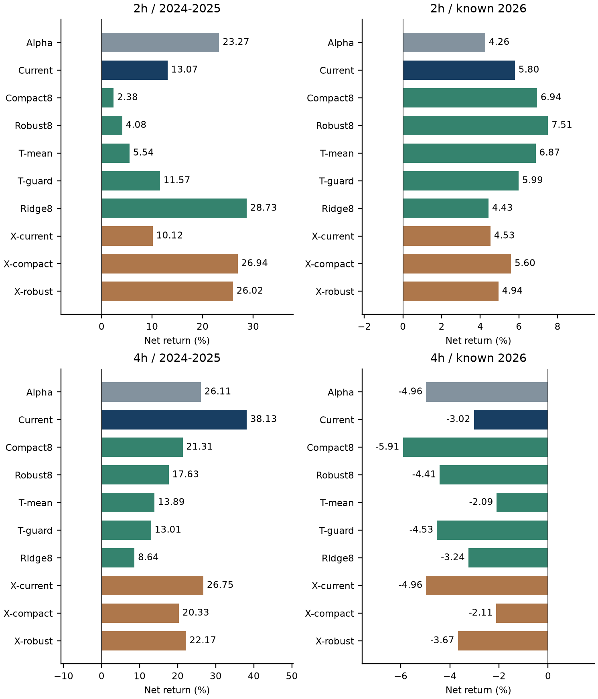

# Generalization Limits of Adaptive AlphaTrend Exit Models in Cryptocurrency Futures

**Author:** wizcap (NEATTRADE project)  
**Version:** 1.0.0, 11 September 2026  
**Status:** Research preprint; not peer reviewed  
**Repository:** https://github.com/wizcap/alphatrend-generalization-study

## Abstract

We investigate whether fixed complexity reduction, robust preprocessing, temporal ensembles, and cross-asset training improve an adaptive AlphaTrend exit policy on Binance BTCUSDT and ETHUSDT USD-M perpetual futures. Ten policies are evaluated at two-hour and four-hour decision intervals. A monthly learner may close an AlphaTrend position at a single 24-hour checkpoint; it cannot create entries. The study uses 355 checksummed public archives, 704 new model fits, 64 frozen reference versions, and 720 asset-accounting windows under baseline friction, doubled friction, and delayed execution. Training consumes only naturally resolved labels known strictly before the monthly boundary minus seven days. The original 18-feature monthly model is compared with eight-feature gradient boosting, training-only winsorization and group weights, three history horizons, an agreement rule, Ridge regression, and opposite-asset training. Improvements are period dependent. At two hours, Ridge raises 2024-2025 net portfolio return from 13.07% to 28.73%, while the already-observed 2026 return falls from 5.80% to 4.43%. At four hours, temporal averaging changes the 2026 result from -3.02% to -2.09% but reduces 2024-2025 return from 38.13% to 13.89%. None of 40 multiplicity-adjusted development-period bootstrap intervals lies entirely above zero. We find insufficient evidence to replace the incumbent model. Independent computational reconciliation supports the implementation and accounting, not future profitability. All evaluation history had previously been inspected; this is a frozen, discovery-only comparison rather than a fresh holdout study.

**Keywords:** cryptocurrency futures; AlphaTrend; adaptive exits; generalization; walk-forward evaluation; backtest overfitting; negative results

## 1. Introduction

A profitable backtest can reflect a small set of favorable market episodes, repeated design choices, or execution assumptions rather than a transferable decision rule. The probability-of-backtest-overfitting literature motivates distinguishing an internally reproducible result from evidence that survives strategy selection [1]. We do not estimate that probability here. Instead, we document a bounded comparison in a previously explored research environment and report the failures alongside the improvements.

The surrounding NEATTRADE research program explored neuroevolution, fixed-architecture optimization, indicator combinations, decision intervals, and adaptive exit management. NEAT evolves both connection weights and topology [2]; CMA-ES is a continuous black-box optimizer [3]. These approaches provide background to the research program, but this paper does not conduct a controlled NEAT-versus-CMA-ES comparison or conclude that either family is generally inferior. Its empirical contribution is the final fixed generalization comparison, designated study015.

AlphaTrend supplies a reproducible rule-based entry and natural-exit process [4]. We investigate whether a small supervised intervention can improve that process without introducing additional entries. The benchmark is the previously constructed monthly histogram gradient-boosting exit learner. The questions are whether a smaller feature/model package improves transfer, whether training-only robust preprocessing helps, whether different training horizons provide useful agreement, and whether a model trained on the other asset behaves economically well.

The contribution is a transparent negative result with unusually detailed computational reconciliation: all registered policies, cost stresses, model slots, and accounting windows are retained. Neither the number of fitted versions nor the number of account replays is treated as an independent statistical sample size.

## 2. Data and study status

### 2.1 Market data and chronology

We use Binance's official public historical data [5]: BTCUSDT and ETHUSDT contract candles, mark-price candles, and funding settlements. The frozen manifest contains 355 archives, including verified repairs for missing coarse candles. The common underlying clock is 15 minutes. Both assets must match the same complete UTC grid. Source coverage begins in January 2022; the continuous label catalog starts on 2 January 2023. Earlier observations support feature construction and initialization.

The development evaluation consists of four separate half-years: January-June 2024, July-December 2024, January-June 2025, and July-December 2025. The known recent context consists of January-June 2026 and 1 July through 31 August 2026 at 20:00 UTC. Monthly versions span January 2024 through August 2026. The 2026 return is approximately eight months of accumulated return, not an annualized estimate. Its truncated final window has a terminal close after about two months; development windows instead close after six months, so horizon and boundary-cost frequency differ.

Every evaluation date had already been used in preceding research. The feature package and research questions therefore inherit prior design exposure to these assets. The method, implementation, tests, environment, and evidence hashes were frozen before the 704 fits and the new comparison results were generated, at 2026-09-11 11:35:55.792173 UTC. This is an internal pre-fit declaration, not an externally timestamped preregistration before access to the underlying data. A separately maintained September shadow replay is outside this paper's evaluation and is not evidence of prospective performance.

### 2.2 What constitutes an observation

The 704 fits are 32 monthly boundaries times two timeframes times 11 new component heads. The 64 cached reference models are additional. The accounting grid is ten policies times two timeframes times six windows times three execution scenarios times two assets: 720 asset accounts and 360 two-asset portfolio accounts. These share prices, trades, labels, and training history; they are not 720 independent market trials.

At two hours, each policy has 161 development checkpoints and 60 recent checkpoints. The development diagnostic sample contains 158 matched, naturally resolved checkpoints, one boundary-protected checkpoint, and two unresolved checkpoints. At four hours, there are 99 development checkpoints, of which 93 are matched and resolved, two boundary protected, and four unresolved; the recent period has 40 checkpoints. Raw actions and diagnostic exclusions are published.

## 3. Methods

### 3.1 Causal AlphaTrend exit intervention

The AlphaTrend implementation follows the attributed Pine source, including its simple-moving-average true-range component [4]. The study-specific portfolio rule is long-or-flat. At an allowed native decision time, the target notional/equity fraction is the positive AlphaTrend state times min(0.5, 0.2 / max(risk_vol, 0.1)). Positions therefore do not exceed 0.5 notional/equity. This sizing rule is part of the research implementation, not a claim to reproduce every TradingView execution setting.

For a natural AlphaTrend episode, let R_natural be the standalone net return under its natural exit and R_early the corresponding return if it is closed at the 24-hour checkpoint. Both include the modeled trading costs and historical funding. The supervised exit label is:

`y = R_natural - R_early`.

A negative prediction favors early exit. A positive prediction retains AlphaTrend. The label is an incremental continuation payoff, not the whole trade's return. Labels become eligible only when the natural exit is observed. Both left-censored episodes and unresolved right-censored outcomes are excluded from training; window-start boundary protection is an additional evaluation rule. The model receives no future episode maximum, minimum, or ultimate duration.

The model version is assigned at the natural entry and remains assigned through a month boundary. Features at the checkpoint use confirmed indicator history and prices strictly before that checkpoint, with the actual delayed entry price used for path features. Natural AlphaTrend exits take priority over a coincident checkpoint. A synthetic episode already active at the beginning of an accounting window is protected: no learned intervention is assigned. Each episode offers only one checkpoint; a stopped episode cannot re-enter before AlphaTrend generates another natural entry.

### 3.2 Monthly cohorts and preprocessing

At a monthly availability time t, an eligible label must be a non-left-censored exit label whose natural payoff became known strictly before t minus seven days. A trailing-horizon cohort additionally requires checkpoint decision time at or after t minus seven days minus its horizon. The 365-day and 730-day filters operate on decision time, not eventual exit time. No validation or future-asset data determine scaling, quantiles, or group weights.

The fixed reduced feature vector is: alpha_distance, alpha_slope, rsi14, atr14_relative, taker_fraction, risk_vol, pnl_atr, and giveback_atr. These are eight coordinates of the original 18-feature checkpoint state. Feature restriction and model regularization change together; their individual effects are not identified by this experiment.

For robust heads, the raw training labels are winsorized at their unweighted 2.5th and 97.5th percentiles using linear interpolation. Rows are retained. Each row in a symbol-by-checkpoint-half-year group of size n_g receives weight proportional to 1/sqrt(n_g), normalized to mean one. Consequently group mass is proportional to sqrt(n_g): this moderates density imbalance but does not equalize groups. A weighted StandardScaler and the estimator receive these same weights. The declared unweighted quantiles describe the empirical row distribution, whereas weighting modifies the subsequent fit; the choice is not a claim that these two operations estimate the same distribution. Robust8 versus Compact8 bundles clipping and weighting and cannot identify their individual contributions. Winsorization changes the fitted estimand away from raw expected payoff; all economic evaluation nevertheless uses original, unclipped outcomes.

Fewer than 20 eligible observations produces an explicit no-model hold decision. If any temporal-ensemble component lacks training support, the whole ensemble holds. In this realized study all 704 new slots were trainable; the smallest cohorts were 35 observations at two hours and 21 at four hours. Meeting the threshold does not guarantee a nonconstant tree model.

### 3.3 Registered policies

Histogram gradient boosting and Ridge use the pinned scikit-learn implementation [6,7]. The following settings and pairings were fixed before the new fits.

| Policy | Inputs and fitting rule | Exit rule |
|---|---|---|
| Alpha | No learner | Natural AlphaTrend exit |
| Current | Frozen original monthly HGB, 18 features, expanding history | Prediction below zero |
| Compact8 | Eight features, smaller HGB, raw y, unit weights | Prediction below zero |
| Robust8 | Compact architecture, clipped training y, group weights | Prediction below zero |
| Temporal mean | Robust heads on expanding, 730-day, and 365-day history | Mean below zero |
| Temporal guard | Same three robust heads | All three strictly below zero |
| Ridge8 | Eight features, robust preprocessing, Ridge alpha=50 | Prediction below zero |
| Transfer current | Original HGB settings; train only the other asset | Prediction below zero |
| Transfer compact | Compact8 settings; train only the other asset | Prediction below zero |
| Transfer robust | Robust8 settings; train only the other asset | Prediction below zero |

The original HGB has 100 iterations, learning rate 0.05, at most seven leaves, minimum leaf sample count 20, and L2 regularization 10. Compact and robust HGB use 100 iterations, learning rate 0.03, at most three leaves, maximum depth two, minimum leaf sample count 20, and L2 regularization 50. All use squared-error loss, seed 11, and no early stopping. Ridge uses the Cholesky solver and alpha 50.

Transfer to BTC uses ETH training rows only; transfer to ETH uses BTC rows only. The excluded asset is removed before every preprocessing operation. This is transfer between two known assets, not evaluation on an untouched asset universe. Temporal components overlap substantially: in both timeframes all three cohorts are identical in one of 32 months, expanding and 730-day cohorts coincide in 13 months, and all three differ in 19 months. Agreement is a structural abstention rule, not a calibrated confidence estimate.

### 3.4 Execution, accounting, and attribution

Baseline execution occurs one 15-minute bar after the decision with total friction of seven basis points on each traded side. Stresses use 14 basis points with the same delay, and seven basis points with a 30-minute delay. Fixed contract units are held between rebalances; same-side target changes below 0.05 of account equity retain the prior units. Historical funding is charged on held units using settlement mark prices. The last position is closed at each accounting window's terminal open and charged its exit cost once. No order-book queue, spread process, price-impact calibration, borrow, or exchange liquidation mechanism is inferred from these data.

Each half-year window starts two equal-capital asset sleeves; their wealth curves are averaged within that window. Portfolio interval returns are then compounded across windows. Boundary liquidation and sleeve reinitialization are therefore part of the reported strategy convention. Monthly model changes do not flatten positions. Drawdown is computed from the running peak of the complete stitched curve, not as the maximum of separately reported window drawdowns. These are simulated research accounts and differ from a continuously maintained live or shadow account.

Loss repair and winner retention use additive per-asset log-wealth attribution over baseline AlphaTrend episodes. Repair divides the change on baseline losing episodes by the magnitude of their baseline loss; retention divides candidate log return on baseline winners by their baseline winning log return. These diagnostic ratios are not portfolio returns. We report all episode contributions and a natural-only subset. Optional forecast-error and two-action-regret diagnostics exclude unmatched or unresolved natural outcomes. Because y is already R_natural minus R_early, exit regret is max(y,0) and hold regret is max(-y,0). The guard's maximum is a policy score; its component mean is used for payoff-error diagnostics. Insufficient models have no payoff forecast.

### 3.5 Inference and computational verification

Ten contrasts per timeframe were declared: Compact8 versus Current; Robust8 versus Compact8; Temporal mean versus Robust8; Temporal guard versus Temporal mean; Ridge8 versus Robust8; each transfer policy versus its matching pooled policy; Temporal guard versus Current; and Temporal guard versus Alpha. Contrasts use paired daily log-return differences from the four development windows only.

For each contrast, circular blocks of either seven or 28 days are sampled separately within each development half-year. Blocks do not cross half-year boundaries. There are 100,000 draws using seed 1015, with each resampled half-year truncated to its original day count. The reported percentile tails are 0.025/40 and 1-0.025/40, conservatively adjusting across all 40 reported intervals. These are empirical bootstrap intervals, not a proof of nominal coverage under nonstationarity. Their extreme tails contain only about 62 draws and have Monte Carlo uncertainty. They do not correct for all preceding research choices. No inference intervals are reported for 2026.

The original computational audit separately reconstructs training membership, clipping quantiles, group weights and scaling; refits every new trained head; manually traverses trees or solves weighted Ridge; rebuilds model-version timing and checkpoint state; and reconciles published scalar accounts with a separately implemented compiled accountant. It also recomputes episode attribution, complete asset/portfolio curves, annual and asset summaries, and all 40 intervals. This is an independent implementation path within one research project, not an external replication or peer review.

## 4. Results

### 4.1 All baseline-friction returns

| TF | Policy | Dev return | Dev DD | Recent return | Recent DD |
|---|---|---:|---:|---:|---:|
| 2h | Alpha | 23.27 | 16.09 | 4.26 | 10.62 |
| 2h | Current | 13.07 | 12.70 | 5.80 | 7.87 |
| 2h | Compact8 | 2.38 | 14.23 | 6.94 | 7.66 |
| 2h | Robust8 | 4.08 | 13.70 | 7.51 | 7.17 |
| 2h | Temporal mean | 5.54 | 15.01 | 6.87 | 6.69 |
| 2h | Temporal guard | 11.57 | 14.80 | 5.99 | 7.46 |
| 2h | Ridge8 | 28.73 | 14.67 | 4.43 | 8.98 |
| 2h | Transfer current | 10.12 | 15.76 | 4.53 | 7.91 |
| 2h | Transfer compact | 26.94 | 16.14 | 5.60 | 8.58 |
| 2h | Transfer robust | 26.02 | 15.84 | 4.94 | 9.15 |
| 4h | Alpha | 26.11 | 14.12 | -4.96 | 16.82 |
| 4h | Current | 38.13 | 9.15 | -3.02 | 11.02 |
| 4h | Compact8 | 21.31 | 11.60 | -5.91 | 17.64 |
| 4h | Robust8 | 17.63 | 11.13 | -4.41 | 16.33 |
| 4h | Temporal mean | 13.89 | 12.68 | -2.09 | 14.30 |
| 4h | Temporal guard | 13.01 | 12.68 | -4.53 | 16.43 |
| 4h | Ridge8 | 8.64 | 15.56 | -3.24 | 14.33 |
| 4h | Transfer current | 26.75 | 11.53 | -4.96 | 16.82 |
| 4h | Transfer compact | 20.33 | 13.71 | -2.11 | 14.32 |
| 4h | Transfer robust | 22.17 | 13.71 | -3.67 | 15.69 |

Table 1. Net portfolio returns and drawdowns in percent. Dev denotes 2024-2025. Recent denotes the already-observed 2026 period through 31 August 20:00 UTC. Returns include the declared friction and historical funding. No column is a fresh holdout estimate.

Figure 1. All ten registered policies at both timeframes. Axes differ between panels. Neither architecture nor timeframe is selected for deployment from this figure.

At two hours, reducing the feature/model package hurts the development-period point estimate: Compact8 returns 2.38% and Robust8 4.08%, versus 13.07% for Current and 23.27% for Alpha. Their recent returns, 6.94% and 7.51%, exceed Current's 5.80% along that particular historical path. Ridge has the opposite tradeoff: development return rises to 28.73%, but recent return falls to 4.43%. These 2026 comparisons are descriptive, not statistically established differences. The highlighted Ridge8-versus-Current and Temporal-mean-versus-Current comparisons are exploratory summaries: they are not additional inferential contrasts in the declared set.

At four hours, all newly proposed pooled packages have lower development return than Current's 38.13%. Temporal mean reduces the recent loss by about 0.93 percentage points, from -3.02% to -2.09%, while sacrificing about 24.24 percentage points of development return. It also has development loss repair of 11.90%, versus 28.50% for Current, and winner retention of 77.50%, versus 92.61%. This exploratory comparison shows a small recent point-estimate gain alongside substantially worse development return and both attribution ratios.

### 4.2 Costs and execution delay

| TF | Policy | D2 | R2 | D30 | R30 |
|---|---|---:|---:|---:|---:|
| 2h | Alpha | 16.59 | 2.08 | 22.73 | 3.86 |
| 2h | Current | 7.10 | 3.62 | 13.79 | 5.45 |
| 2h | Compact8 | -2.95 | 4.73 | 1.07 | 6.57 |
| 2h | Robust8 | -1.33 | 5.29 | 3.03 | 7.64 |
| 2h | Temporal mean | 0.01 | 4.68 | 5.12 | 7.13 |
| 2h | Temporal guard | 5.72 | 3.80 | 11.65 | 6.10 |
| 2h | Ridge8 | 21.85 | 2.27 | 27.40 | 4.55 |
| 2h | Transfer current | 4.19 | 2.37 | 14.32 | 5.56 |
| 2h | Transfer compact | 20.07 | 3.42 | 26.42 | 5.64 |
| 2h | Transfer robust | 19.20 | 2.78 | 25.71 | 4.53 |
| 4h | Alpha | 22.18 | -6.22 | 26.41 | -4.10 |
| 4h | Current | 33.97 | -4.26 | 38.96 | -1.52 |
| 4h | Compact8 | 17.67 | -7.13 | 21.67 | -5.03 |
| 4h | Robust8 | 14.12 | -5.63 | 17.61 | -2.97 |
| 4h | Temporal mean | 10.50 | -3.36 | 14.16 | -1.58 |
| 4h | Temporal guard | 9.59 | -5.76 | 13.20 | -3.00 |
| 4h | Ridge8 | 5.48 | -4.52 | 8.65 | -2.26 |
| 4h | Transfer current | 22.88 | -6.20 | 27.21 | -4.01 |
| 4h | Transfer compact | 16.61 | -3.39 | 20.65 | -0.27 |
| 4h | Transfer robust | 18.39 | -4.92 | 22.56 | -2.68 |

Table 2. Complete net return stress grid in percent. D2/R2 denote development/recent with doubled friction; D30/R30 denote development/recent with 30-minute execution. A later execution can help or hurt a realized trade path. This scenario is a timing stress, not a guaranteed monotonic return penalty. Detailed order counts, turnover, friction payments and funding payments are included in the released asset-account table.

### 4.3 Transfer, agreement, and effective support

Two-hour Transfer compact returns 26.94% during development, but intervenes at only ten of 161 checkpoints. Its loss repair is 4.53% and winner retention 99.87%; much of its behavior remains close to the Alpha reference. A large improvement over a weak pooled Compact8 reference cannot, by itself, establish transferable learned structure. Two-hour Ridge exits at 32 development checkpoints and retains 95.19% of baseline winner log return, but it does not dominate Current across periods or both assets.

Low support is particularly evident in four-hour transfer heads. For each of the three transfer families, nine BTC-excluded and ten ETH-excluded monthly versions have only constant trees. At two hours, two ETH-excluded versions per transfer family are constant. None of the new pooled HGB heads is constant across all trees. With a minimum leaf count of 20, fewer than 40 rows cannot support two leaves; such a fit can still learn a positive or negative constant and is not necessarily a no-op. These fitted constant models differ from no-model abstention, even though both may frequently retain Alpha. The full model-cohort and decision-count tables are released. The near-Alpha comparison is behavioral description, not a declared transfer-versus-Alpha hypothesis test.

Matching rounded fields do not imply duplicated strategies. Four-hour Transfer compact and Transfer robust share the same development loss repair to numerical tolerance because their only materially different development episode contribution is a baseline-winning BTC episode in 2025H2. Four-hour Transfer current makes 12 recent early exits even though its recent return rounds to the same three-decimal value as Alpha. The full paths and episode audit distinguish these cases.

### 4.4 Statistical and computational results

None of the 40 adjusted intervals is wholly positive. Thirty-nine contain zero. At the contrast level, 19 of 20 contrasts contain zero under both block lengths, and one contains zero under seven-day blocks only. For four-hour Temporal guard versus Current, the seven-day interval is [-0.46478, 0.01261] in log-wealth difference, whereas the 28-day interval is [-0.40771, -0.04035]. The latter suggests harm under that block analysis, but the sign evidence is not stable across the two block lengths. Longer blocks need not monotonically increase conditional bootstrap variance. Circular wrapping also creates artificial end-to-start joins within a half-year. Both effects reinforce the need to report both analyses rather than select the negative interval. All interval endpoints are included in Appendix C. No ex ante power target or minimum economically meaningful effect was specified, so failure to find a positive interval is not a proof that every treatment has zero value.

The original verification passes 303 automated tests, independently refits all 704 new models, checks 64 frozen reference versions, reconciles 720 complete asset accounts, 23,010 action events, 12,210 episode attributions and 3,600 diagnostic rows, and recomputes 40 intervals. Alpha and Current reproduce the preceding study013 results and full portfolio curves in every registered scenario. Original source/evidence fingerprints and private shadow state remain unchanged. These checks establish computational consistency within the implemented assumptions; they cannot establish future economic profitability.

## 5. Discussion and limitations

The central finding is a lack of stable evidence for replacing the existing monthly exit model with the proposed generalization packages. Architectural simplicity is not sufficient evidence of economic robustness. A conservative agreement rule can also discard useful interventions when its overlapping heads share biases. Conversely, near-Alpha transfer behavior can look favorable when compared with a poor pooled learner, without providing strong evidence of transfer skill.

Several restrictions limit interpretation. First, only two highly related, previously studied assets are used. Removing one asset from fitting does not remove it from the history of design decisions. Second, the relatively small number of completed episodes limits effective training and evaluation support. Third, all models and timeframes are hypothetical historical reconstructions; their model creation times were not timely live decisions. Fourth, clipping changes the response estimand, and feature selection, depth, learning rate and regularization are bundled rather than orthogonally ablated. Fifth, half-year resets, constant friction, bar-based delays and omitted microstructure effects limit execution realism. Sixth, historical model-version dependence and market nonstationarity limit the interpretation of bootstrap tails. The within-study adjustment is not a correction for the whole research program.

Future work should declare the asset universe and candidate changes before evaluation, retain delisted assets when applicable, collect genuinely subsequent observations after model creation, and separate feature restriction from regularization and response transformation. Such studies would test hypotheses; the present results do not justify continuing to tune this same history until a favorable headline appears. No new universe or model was selected after seeing study015.

## 6. Conclusion

Fixed feature/model restriction, robust preprocessing, temporal aggregation and opposite-asset training did not provide sufficiently consistent evidence of improved generalization in this AlphaTrend exit setting. Some point estimates improve, but the improvements vary across timeframes, periods and asset directions. The operational conclusion is to retain the existing research/shadow configuration and leave deployment selection empty. The transferable contribution of this work is the explicit timing, cost accounting, negative-result reporting and reproducibility record, rather than a claim to have discovered a deployable profitable strategy.

## Reproducibility, authorship, and disclosures

The repository releases the manuscript, Traditional Chinese interpretation, source and tests, all study015 tables and derived curves, fitted research models, frozen labels, official source URLs/checksums, and the original verification record. Public reproduction commands distinguish numerical result/interval verification, model refitting, raw-data retrieval and full market replay. Original research entry points may refer to earlier private bookkeeping artifacts; use the publication wrapper and its documented paths. Raw exchange archives are retrieved from the provider rather than redistributed, and private operational state, credentials and machine environments are excluded. The public wrapper does not claim to verify unpublished operational-state hashes.

The complete findings and numeric tables were prepared with Codex assistance. Claude performed automated design, implementation and results critiques; the manuscript received an additional automated editorial check. Automated critique is not external scientific peer review. The GitHub maintainer is credited by the public account identifier wizcap, without an invented institutional affiliation. No exchange account history or live-order profitability is used in this paper. The release has no journal acceptance or assigned DOI.

## References

1. Bailey, D. H., Borwein, J. M., Lopez de Prado, M., and Zhu, Q. J. (2017). The Probability of Backtest Overfitting. Journal of Computational Finance, 20(4), 39-69. DOI: 10.21314/JCF.2016.322. Institutional record: https://scholarworks.wmich.edu/math_pubs/42/
2. Stanley, K. O., and Miikkulainen, R. (2002). Evolving Neural Networks through Augmenting Topologies. Evolutionary Computation, 10(2), 99-127. https://nn.cs.utexas.edu/downloads/papers/stanley.ec02.pdf
3. Hansen, N. (2016). The CMA Evolution Strategy: A Tutorial. arXiv:1604.00772. https://arxiv.org/abs/1604.00772
4. KivancOzbilgic. AlphaTrend Strategy. TradingView open-source Pine strategy; source under Mozilla Public License 2.0. Retrieved 11 September 2026. https://www.tradingview.com/script/3wdQu7P3-AlphaTrend-Strategy/
5. Binance. Binance Public Data. Public futures archive documentation and download conventions. https://github.com/binance/binance-public-data
6. scikit-learn developers. HistGradientBoostingRegressor, version 1.9.1 documentation. https://scikit-learn.org/stable/modules/generated/sklearn.ensemble.HistGradientBoostingRegressor.html
7. scikit-learn developers. Ridge, version 1.9.1 documentation. https://scikit-learn.org/stable/modules/generated/sklearn.linear_model.Ridge.html

## Appendix A. Frozen training feature order

The original checkpoint vector is: alpha_state, alpha_distance, alpha_slope, alpha_mfi, rsi14, macd_hist, ema12_26, ret6, bollinger42, atr14_relative, volume_z42, taker_fraction, risk_vol, pnl_atr, mfe_atr, mae_atr, giveback_atr, and settled_funding_10bps. The reduced package selects zero-based indices [1,2,4,9,11,12,13,16]. The path coordinates are bounded by the original implementation; no full-episode extrema are supplied at inference.

## Appendix B. Reading the released evidence

`evidence/study015/report.json` contains every policy/window/scenario metric and all contrasts. `asset_results.csv` exposes per-asset orders, friction and funding. `accounts/` stores all asset equity, target and allowed-trading arrays; the four group equity archives contain stitched portfolio curves. `actions.json`, `trades.json`, `diagnostics.json`, and `diagnostic_summary.json` expose decisions, attribution and exclusions. `models/`, `reference_models/` and `labels.json` support independent refitting. `raw_manifest.json` supplies the 355 official archive locations and hashes. `protocol.json` and `verification.json` are the unchanged original study records. `PUBLIC_MANIFEST.json` records hashes for the curated public release; it is distinct from the original private delivery package.

## Appendix C. Every declared contrast

Endpoints are in log-wealth-difference units, not percentage-point return. X denotes opposite-asset training; T denotes temporal aggregation.

| TF | Candidate versus reference | Point | 7-day interval | 28-day interval |
|---|---|---:|---|---|
| 2h | Compact8 vs Current | -0.0993 | [-0.3221, 0.1023] | [-0.3546, 0.0844] |
| 2h | Robust8 vs Compact8 | 0.0165 | [-0.0309, 0.0750] | [-0.0230, 0.0695] |
| 2h | T-mean vs Robust8 | 0.0139 | [-0.0885, 0.1520] | [-0.0606, 0.1052] |
| 2h | T-guard vs T-mean | 0.0556 | [-0.0669, 0.2371] | [-0.0643, 0.2834] |
| 2h | Ridge8 vs Robust8 | 0.2125 | [-0.0764, 0.5467] | [-0.0776, 0.5508] |
| 2h | X-current vs Current | -0.0264 | [-0.3301, 0.2746] | [-0.3424, 0.2822] |
| 2h | X-compact vs Compact8 | 0.2150 | [-0.0432, 0.5415] | [-0.0469, 0.5288] |
| 2h | X-robust vs Robust8 | 0.1912 | [-0.0562, 0.5058] | [-0.0595, 0.5036] |
| 2h | T-guard vs Current | -0.0133 | [-0.1985, 0.1974] | [-0.1562, 0.1484] |
| 2h | T-guard vs Alpha | -0.0997 | [-0.3619, 0.0972] | [-0.3560, 0.1027] |
| 4h | Compact8 vs Current | -0.1298 | [-0.3837, 0.0792] | [-0.3440, 0.0332] |
| 4h | Robust8 vs Compact8 | -0.0308 | [-0.2332, 0.0916] | [-0.2171, 0.0792] |
| 4h | T-mean vs Robust8 | -0.0323 | [-0.1818, 0.0918] | [-0.1945, 0.0929] |
| 4h | T-guard vs T-mean | -0.0077 | [-0.0986, 0.1344] | [-0.1004, 0.1457] |
| 4h | Ridge8 vs Robust8 | -0.0795 | [-0.3877, 0.2196] | [-0.4137, 0.2279] |
| 4h | X-current vs Current | -0.0860 | [-0.2904, 0.1031] | [-0.2734, 0.0668] |
| 4h | X-compact vs Compact8 | -0.0082 | [-0.1991, 0.2580] | [-0.1664, 0.2189] |
| 4h | X-robust vs Robust8 | 0.0378 | [-0.1743, 0.3447] | [-0.1581, 0.3292] |
| 4h | T-guard vs Current | -0.2007 | [-0.4648, 0.0126] | [-0.4077, -0.0403] |
| 4h | T-guard vs Alpha | -0.1096 | [-0.3682, 0.0715] | [-0.3840, 0.0662] |
